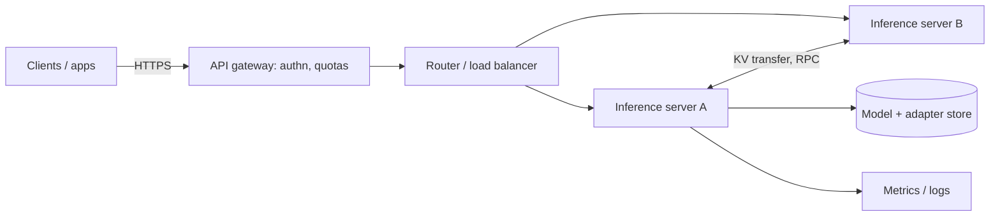

# The Problem: Model Servers as Shared Infrastructure

An LLM inference server is a long-running process that holds model weights in GPU memory, accepts prompts over HTTP or gRPC, schedules them into batches and streams tokens back. vLLM, SGLang, Ollama, llama.cpp's server, Hugging Face TGI and NVIDIA Triton Inference Server all fit this description. They were built for throughput first. Security features such as authentication, tenant isolation and audit logging arrived later, are often optional, and are frequently left off in the copy-pasted `docker run` line that ends up in production.

This book treats the inference server as what it has become: shared infrastructure that processes some of the most sensitive text an organisation has (system prompts, retrieved documents, customer conversations, source code) on hardware that is expensive enough to be shared between teams, customers and workloads.

## Why the serving layer is its own attack surface

Application-level LLM security (prompt injection, jailbreaks, unsafe tool use) is covered in **llm-jailbreak-engineering-for-defenders** and **ai-red-teaming-security-copilots**. Model provenance and malicious weight files are covered in **ml-model-supply-chain-security**. This book sits between them, at the layer that most teams treat as plumbing.

Three properties make the serving layer distinctive:

1. **Shared state across requests.** To reach high throughput, servers batch requests from different users into the same forward pass and reuse computed key-value (KV) cache blocks across requests that share a prefix. The PagedAttention paper (Kwon et al., 2023) describes this sharing as a feature: the KV cache of a common system prompt can be stored once and mapped into many requests "similar to how OS handles shared library across processes". Sharing is efficient, and every shared structure is a potential channel between tenants.
2. **Optimised, observable timing.** Cache hits make requests faster. Anything that changes latency in a data-dependent way can become a timing side channel.
3. **Management APIs next to inference APIs.** Many servers expose model pull, load, unload, adapter registration, pause and metrics endpoints on the same port as inference. The OWASP Top 10 for LLM Applications lists Model Denial of Service (LLM04) and Model Theft (LLM10) separately; at the serving layer both often reduce to "an unauthenticated management endpoint was reachable".

The pattern is not new. Sheila A. Berta's talk *The Unbelievable Insecurity of the Big Data Stack* walks through ZooKeeper, Hadoop RPC and exposed dashboards that ran without authentication because they were "internal". Inference servers repeat that history: fast-moving open-source data-plane software, designed for trusted clusters, deployed on networks that are not trusted.

## Assets

| Asset | Where it lives | Why it matters |
|---|---|---|
| Prompts and completions | request buffers, KV cache, logs | confidential user and business data |
| System prompts and RAG context | shared prefix cache | intellectual property; reveals guardrails |
| Model weights and LoRA adapters | GPU memory, local disk, model cache | expensive to train; may be licensed |
| GPU capacity | the scheduler | denial of service, cost abuse, cryptomining |
| Host and cluster credentials | environment, mounted secrets | pivot from the server to the cluster |

## Adversaries

- **Internet scanner.** Finds exposed ports such as Ollama's default 11434 and enumerates models, pulls weights or burns compute. Wiz Research reported more than 1,000 internet-exposed Ollama instances in June 2024 while disclosing CVE-2024-37032 ("Probllama").
- **Co-tenant.** A legitimate user of a shared endpoint who tries to learn other users' prompts through shared caches, timing or response metadata.
- **Network observer.** Sees only encrypted traffic but can measure packet sizes and timing. Wen Ming Liu and Lingyu Wang's *Preserving Privacy Against Side-Channel Leaks* shows how web application inputs can be inferred "from the packet sizes even if the traffic between client and server sides is encrypted"; streaming token responses give the same kind of signal.
- **Malicious model or adapter supplier.** Ships a file that executes code when loaded, or a model that behaves badly under specific inputs.
- **Insider or compromised workload** in the same cluster that can reach internal ports (distributed KV transfer, metrics, engine RPC) that were never meant to face anything hostile.

## A reference deployment



Every arrow is a trust boundary that tends to be unauthenticated by default. In later chapters we harden each one.

## Scope and rules of engagement

Everything in this book is for systems you own or are explicitly authorised to test. Timing and cache experiments are run against a local server with canary strings such as `ACME-CANARY-7731`, never against third-party services. If you find a vulnerability in a serving framework, report it through the project's security policy (vLLM, Ollama and NVIDIA all publish one) and follow coordinated disclosure.

## Worked example

> **Execution status:** Steps 1–2 were run on the author's workstation against a local Ollama 0.40.7 install; the observed output is quoted. Step 3 is a desk exercise.

**Step 1: find what is listening.** On a host that runs a model server:

```bash
ss -ltn | grep -E '11434|8000|8001|8002|30000'
```

Observed: `LISTEN 0 4096 127.0.0.1:11434 0.0.0.0:*`. The default Linux install of Ollama binds to loopback only, which matches Wiz's description of the default.

**Step 2: ask the server what it will tell anyone who can reach it.**

```bash
curl -s http://127.0.0.1:11434/api/version
curl -s http://127.0.0.1:11434/api/tags | jq '.models[].name'
```

Observed: the version string and the full model inventory (name, digest, size, quantisation, context length) came back with no credential. On loopback that is fine. If `OLLAMA_HOST=0.0.0.0` is set, or the container publishes the port, the same inventory is available to the network.

**Step 3: write a one-page threat model** for your deployment using the asset and adversary tables above. For each arrow in the diagram, record: authenticated? encrypted? who can reach it? This page is the input to the checklist in the final chapter.

## Common pitfalls

- **Treating the server as an internal library.** It is a network service with management functions; review it like one.
- **Assuming the reverse proxy protects every route.** Proxies often forward the whole path space, including admin and metrics routes.
- **Ignoring internal ports.** Distributed serving adds RPC and KV-transfer sockets that may bind to all interfaces.
- **Forgetting that prompts persist.** KV cache, request logs and debugging traces all hold prompt text after the response is sent.
- **Testing timing attacks on shared production services.** Use a local lab; you will otherwise affect other users and may break terms of service or law.

## Exercises

1. Inventory every inference server in your environment (include developer laptops). Record listening address, version and whether any authentication is configured.
2. Draw your deployment as in the diagram above and mark each arrow as authenticated, encrypted, both or neither.
3. Pick one adversary from the list and write three concrete attack steps against your deployment, then one control that breaks each step.

## Further reading

- Kwon et al., *Efficient Memory Management for Large Language Model Serving with PagedAttention* (SOSP 2023).
- OWASP Top 10 for LLM Applications: LLM04 Model Denial of Service and LLM10 Model Theft.
- Sheila A. Berta, *The Unbelievable Insecurity of the Big Data Stack* (conference talk).
- Wen Ming Liu and Lingyu Wang, *Preserving Privacy Against Side-Channel Leaks: From Data Publishing to Web Applications* (Springer).
- Wiz Research, "Probllama: Ollama Remote Code Execution Vulnerability (CVE-2024-37032)" (2024): <https://www.wiz.io/blog/probllama-ollama-vulnerability-cve-2024-37032>
