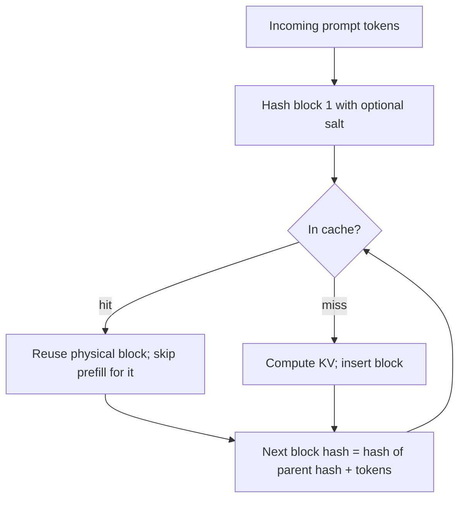

# Serving Architecture: Batching, Paged Attention and Prefix Caching

You cannot reason about leakage between tenants until you know which data structures they share. This chapter walks through the request path of a modern LLM server and marks every place where one request's data meets another's.

## Two phases of generation

Autoregressive generation has two phases. In **prefill**, the server processes all prompt tokens in parallel and computes a key and value vector per token per layer. In **decode**, it generates one token at a time; each new token attends to the keys and values of every earlier token. Storing those vectors instead of recomputing them is the **KV cache**. The PagedAttention paper (Kwon et al., 2023) notes that "the KV cache of one token depends on all its previous tokens", so the cache for position *n* is only reusable by a request whose first *n* tokens are identical. That property is what makes prefix caching possible, and what makes it a side channel.

KV caches are large. Their size grows with layers × heads × head dimension × sequence length × batch size, and for long contexts the cache can exceed the weights. Memory, not arithmetic, usually limits how many requests a GPU can serve at once.

## Batching: from static to continuous

| Technique | Source | What it shares | Security note |
|---|---|---|---|
| Static batching | classic serving | one forward pass for N padded requests | requests finish together; little data-dependent timing |
| Iteration-level (continuous) batching | Orca (Yu et al., OSDI 2022) | scheduler admits and retires requests every decode step | one tenant's long output changes others' latency |
| Preemptive scheduling | FastServe (Wu et al., 2023) | jobs preempted per output token; KV cache swapped to host memory | prompt state moves to CPU RAM; queue position leaks load |
| Speculative decoding | SpecInfer and others | a small draft model proposes tokens, the large model verifies | acceptance rate depends on content, so latency does too |

Orca's paper proposes "iteration-level scheduling" and "selective batching": the scheduler decides at every iteration which requests run, instead of waiting for a whole batch to finish. FastServe goes further and uses a multi-level feedback queue with "preemption at the granularity of each output token", which forces it to keep or swap KV caches of preempted jobs. Each refinement improves throughput and makes per-request latency depend more on what other tenants are doing.

## PagedAttention and the block table

vLLM's PagedAttention borrows virtual memory from operating systems. The KV cache of each sequence is split into fixed-size **blocks** (for example 16 tokens). A per-sequence **block table** maps logical blocks to physical blocks anywhere in GPU memory. Benefits reported by the authors include near-zero fragmentation and "flexible sharing of KV cache within and across requests", with 2–4× throughput gains over FasterTransformer and Orca at the same latency.

Three sharing mechanisms in the paper matter for security:

1. **Parallel sampling and beam search** share prompt blocks between candidate outputs of one request, using reference counts and copy-on-write. This sharing stays within a request.
2. **Shared prefix.** The service provider can reserve physical blocks for "predefined shared prefixes" such as a system prompt; a new request maps its logical blocks onto them with the last block marked copy-on-write. This sharing crosses requests and possibly users.
3. **Swapping and recomputation.** Under memory pressure vLLM evicts blocks, either copying them to CPU RAM or dropping and recomputing them later. Prompt-derived state therefore also lives in host memory.

## Automatic prefix caching

The original paper describes prefixes the operator declares in advance. Production engines generalised this to **automatic prefix caching**: every full block is hashed together with the hash of its parent block, and identical hash chains are reused across any requests. SGLang's RadixAttention organises the same idea as a radix tree over token sequences. The vLLM design documentation describes the hash chain and a `cache_salt` field that is mixed into the first block's hash so that "only requests with the same salt can reuse cached KV blocks".

Once caching is automatic, any two requests that share a block-aligned prefix share GPU memory, whoever sent them. The cache is now a global, content-addressed store, and its hit or miss status shows up as time-to-first-token (TTFT).



## Distributed and disaggregated serving

Large deployments split prefill and decode onto different GPUs and move KV caches between them over the network, or offload caches to CPU memory, local SSD or a shared cache service. Each split adds a socket. One example of what can go wrong: CVE-2025-32444 affected vLLM's Mooncake integration (versions 0.6.5 to before 0.8.5). Its ZeroMQ sockets listened on all interfaces and deserialised incoming data with `pickle.loads()`, so anyone who could reach them could run code. Chapter 5 returns to deserialisation; the architectural point is that KV transfer is a data plane full of user prompts and needs the same protection as the API.

## Where tenant data meets

| Structure | Lifetime | Shared across tenants? |
|---|---|---|
| Request queue and scheduler state | seconds | yes (metadata) |
| Activations in a batched forward pass | one step | yes (same kernels, separate rows) |
| KV cache blocks | until evicted | yes with prefix caching |
| Swapped KV blocks in CPU RAM / SSD | until reused or freed | yes |
| Logs, traces, metrics labels | days to months | yes, if prompts are logged |
| GPU local/shared memory scratch | one kernel | only if hardware fails to clear it (see **gpu-security-ai-infrastructure**) |

## Worked example

> **Execution status:** Not executed in this book's CI; verify locally. It needs a GPU host with vLLM installed.

Observe prefix caching directly on a lab vLLM instance.

```bash
vllm serve Qwen/Qwen2.5-0.5B-Instruct --enable-prefix-caching \
  --host 127.0.0.1 --port 8000
```

Send the same long canary prefix twice and a different prefix once, timing TTFT with streaming:

```bash
PREFIX="System: You support ACME-CANARY-7731. $(printf 'Rule %s. ' $(seq 1 200))"
for tail in "Q1" "Q2"; do
  curl -s -o /dev/null -w '%{time_starttransfer}\n' http://127.0.0.1:8000/v1/completions \
    -H 'Content-Type: application/json' \
    -d "{\"model\":\"Qwen/Qwen2.5-0.5B-Instruct\",\"prompt\":\"$PREFIX $tail\",\"max_tokens\":1,\"stream\":true}"
done
```

Then scrape `http://127.0.0.1:8000/metrics` and look for the prefix-cache hit counters (names vary by version; search for `prefix_cache`). Expect the second request's TTFT to drop and the hit counter to rise. Record both numbers; chapter 4 builds the side-channel test on them.

## Common pitfalls

- **Thinking batching implies data mixing.** Batched rows are computed separately; the shared parts are caches, timing and memory, not the arithmetic.
- **Forgetting host memory.** Swapped or offloaded KV blocks hold prompt state in CPU RAM and on disk.
- **Assuming the cache is per user.** Automatic prefix caching is global unless salted or partitioned.
- **Treating KV transfer sockets as trusted.** They carry prompts and, as CVE-2025-32444 showed, can be code-execution paths.
- **Ignoring speculative decoding.** Content-dependent acceptance rates change latency too.

## Exercises

1. For your serving engine and version, find out whether prefix caching is on by default and how cache keys are computed. Cite the documentation page.
2. List every network socket opened by a two-node distributed deployment of your engine (`ss -ltnp` on each node) and classify each one as API, management, RPC or KV transfer.
3. Estimate the KV cache size for your model at your maximum context length and batch size, and compare it with weight size.

## Further reading

- Kwon et al., *Efficient Memory Management for Large Language Model Serving with PagedAttention* (SOSP 2023).
- Yu et al., *Orca: A Distributed Serving System for Transformer-Based Generative Models* (OSDI 2022).
- Wu et al., *Fast Distributed Inference Serving for Large Language Models* (FastServe, 2023).
- Miao et al., *SpecInfer: Accelerating Generative Large Language Model Serving with Speculative Inference and Token Tree Verification* (2023).
- vLLM design docs, "Automatic Prefix Caching": <https://docs.vllm.ai/en/stable/design/prefix_caching.html>
- NVD entry for CVE-2025-32444: <https://nvd.nist.gov/vuln/detail/CVE-2025-32444>
