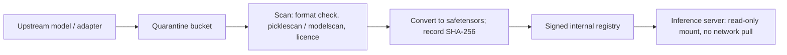

# Resource Exhaustion and Model/Adapter Loading Risks

Two risks remain once endpoints are locked down and caches are scoped. Authenticated callers can still exhaust GPU capacity, and the server must load model and adapter files that may come from people you do not fully trust. Both are classic problems (denial of service, untrusted deserialisation) in a new shape.

## Why LLM requests are easy to make expensive

The cost of a request is not its byte size. It depends on:

- **Prompt length,** which drives prefill compute and KV cache memory.
- **Requested output length** (`max_tokens`), which drives decode steps and holds KV cache for the whole generation.
- **Sampling fan-out** (`n`, `best_of`, beam width), which multiplies sequences.
- **Structured-output constraints** (JSON schema, regex grammars), which add CPU work per token and can be pathologically slow to compile.
- **Multimodal inputs,** where an image or audio clip expands into many tokens and needs preprocessing.
- **LoRA adapter selection,** which may force an adapter load or eviction.

The OWASP Top 10 for LLM Applications entry LLM04 (Model Denial of Service) lists "resource-consuming queries, repetitive inputs, and volume-based attacks" and recommends rate limiting, request validation and throttling. At the serving layer that guidance becomes concrete limits on each factor above.

Under continuous batching (chapter 2), a few requests with maximal context and maximal output can occupy most KV cache blocks. The scheduler must then preempt, swap or queue everyone else. FastServe's authors note that preemptive scheduling "has to keep the key-value cache in the GPU memory for all preempted jobs", which is exactly the pressure an attacker creates. Throughput falls for every tenant, not just the attacker.

## Limits that work

| Control | Where | Example |
|---|---|---|
| Max prompt tokens | engine and gateway | `--max-model-len`; gateway rejects bodies over N tokens using the same tokenizer |
| Max output tokens | gateway | clamp `max_tokens` per tier |
| Fan-out caps | gateway | reject `n > 1`, `best_of`, large beams unless allow-listed |
| Token-based rate limits | gateway | tokens per minute per key, not requests per minute |
| Concurrency per tenant | gateway / router | at most K in-flight requests per key |
| Timeouts | engine and gateway | wall-clock deadline; cancel generation on client disconnect |
| Grammar limits | engine | cap schema size and nesting; compile with timeouts; cache compiled grammars |
| Queue admission | engine | `--max-num-seqs`; return 429 quickly instead of queuing forever |
| Priority classes | router | protect interactive traffic from batch jobs |

Count tokens with the server's own tokenizer, not by characters. Tokenizer behaviour on unusual Unicode can turn a short string into many tokens; see **tokenizer-text-encoding-attacks**.

## Cost abuse is DoS with an invoice

On metered cloud GPUs or upstream API keys, an exposed endpoint becomes a bill. Treat per-key spend alerts as a security control: alert on sudden token-volume increases, new source networks, and use of rarely used models or adapters.

## Model and adapter loading

Servers load three kinds of artefact: base weights, tokenizer and config files, and adapters (LoRA). Each has failure modes.

**Deserialisation.** PyTorch's legacy checkpoint format is Python pickle. Mark Summerfield's *Programming in Python 3* states the problem plainly: pickles "have no security mechanisms (no encryption, no digital signature)" and loading one "that comes from an untrusted source could be dangerous" because it can "import arbitrary modules and call arbitrary functions". Prefer `safetensors`, which stores raw tensors and metadata only. Recent PyTorch defaults `torch.load` to `weights_only=True`, which narrows but does not remove pickle risk. The same problem shows up in transport: CVE-2025-32444 (vLLM's Mooncake integration) deserialised network messages with pickle.

**Remote code in model repos.** Hugging Face's `trust_remote_code=True` executes Python shipped with the model. Never enable it for models you have not reviewed and pinned by commit hash.

**Parser bugs.** GGUF, ONNX and TensorRT engine files are parsed by native code. A malformed file can trigger memory corruption. Treat model parsing like image parsing: untrusted input, sandboxed process.

**Path handling.** Model names often become file paths. Probllama (CVE-2024-37032) was a path traversal in Ollama's model pull handling that could lead to file overwrite and code execution.

**Dynamic adapter loading.** Multi-LoRA serving lets callers name an adapter per request, and some engines can load adapters at runtime from a path or a hub ID. If a caller can make the server fetch an arbitrary adapter, that is server-side request forgery plus untrusted model loading. Even well-formed adapters can change model behaviour in targeted ways, which **ml-model-supply-chain-security** covers in depth.

## A safe loading pipeline



The server loads only from the registry, by digest, from a read-only volume, with runtime model pulling and adapter loading disabled or restricted to an allow-list.

## Worked example

> **Execution status:** Not executed in this book's CI; verify locally. All commands are against a lab server you own.

**Step 1: measure the cost asymmetry.** With a lab vLLM server, send one request with a 50-token prompt and `max_tokens: 16`, and one with a prompt near `--max-model-len` and `max_tokens` at the limit. Record latency, and watch `nvidia-smi --query-gpu=memory.used --format=csv -l 1` and the engine's KV-cache-usage metric during each.

**Step 2: show the shared impact.** Start 20 concurrent maximal requests with a load tool such as `hey` or `k6`, then time a small request from another key. Note its TTFT increase.

**Step 3: apply limits** at the gateway: token-per-minute limit per key, `max_tokens` clamp, concurrency 2 per key. Repeat step 2; the small request's TTFT should stay close to baseline while the maximal ones receive 429s.

**Step 4: audit loading paths.**

```bash
pip install modelscan
modelscan -p ./models/
grep -rn "trust_remote_code" deploy/ src/
```

Every `trust_remote_code=True` needs a reviewed, pinned revision and an owner. Every non-safetensors weight file needs a justification or a conversion.

## Common pitfalls

- **Rate limiting by requests, not tokens.** One request can cost a thousand times another.
- **Letting generation continue after the client disconnects.** Abandoned requests still burn GPU time.
- **Counting characters instead of tokens** at the gateway.
- **Enabling runtime adapter loading from arbitrary paths or hub IDs.**
- **Assuming `weights_only=True` makes pickles safe.** It reduces risk; safetensors removes the code path.
- **Running the server with write access to its model directory,** which turns path traversal into persistence.

## Exercises

1. Build a table of per-request cost drivers for your engine and set a limit for each one. Prove each limit with a test request that should be rejected.
2. Write a gateway policy that enforces tokens-per-minute per API key, and load-test it.
3. Run `modelscan` (or `picklescan`) over your model store and convert any pickle-based weights to safetensors. Record digests in a manifest the server verifies at start-up.

## Further reading

- OWASP Top 10 for LLM Applications, LLM04 Model Denial of Service and LLM05 Supply Chain Vulnerabilities.
- Mark Summerfield, *Programming in Python 3* (pickle security notes).
- Wu et al., *Fast Distributed Inference Serving for Large Language Models* (FastServe, 2023).
- Hugging Face safetensors: <https://github.com/huggingface/safetensors>
- Protect AI modelscan: <https://github.com/protectai/modelscan>
- NVD, CVE-2025-32444: <https://nvd.nist.gov/vuln/detail/CVE-2025-32444>
