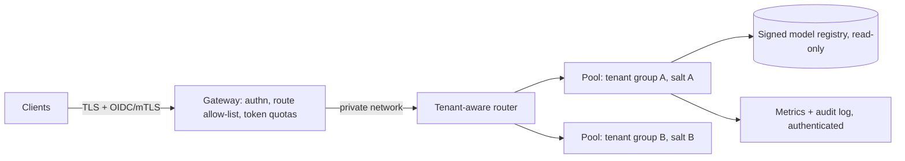

# Hardening, Monitoring and a Security Programme

This chapter turns the previous five into a deployable baseline, a monitoring plan and a list of open research questions. Use it as a checklist for new deployments and as an audit template for existing ones.

## Reference architecture



The principles behind it:

1. **Only the gateway is reachable.** Engines bind to loopback or a private interface; NetworkPolicies restrict who can reach them.
2. **Identity on every request.** The gateway authenticates and passes a tenant ID downstream; the engine never trusts tenant headers from clients.
3. **Cache domain ⊆ trust domain.** Separate pools or per-tenant salts, chosen by data sensitivity.
4. **Artefacts by digest.** Models and adapters come from a signed registry on read-only mounts, with runtime pulls disabled.
5. **Bounded cost.** Token quotas, concurrency limits and deadlines per tenant.

## Hardening checklist

| # | Control | Verify with |
|---|---|---|
| 1 | Engine listens on loopback/private IP only | `ss -ltnp`; external scan |
| 2 | Container ports published to `127.0.0.1` or not at all | compose/manifest review in CI |
| 3 | Gateway allow-lists exact paths and methods | route-by-route unauthenticated test |
| 4 | Management routes (pull, load, unload, pause, weight update, cache flush) unreachable from clients | 404/403 from outside |
| 5 | Metrics endpoint authenticated; no prompt text or tenant secrets in labels | scrape without credentials fails |
| 6 | Internal RPC / KV-transfer sockets on private network with mTLS where supported | `ss -ltnp` on every node; NetworkPolicy test |
| 7 | Prefix caching scoped (pool per trust domain or salt per tenant) | AUC test from chapter 4 |
| 8 | Semantic caches keyed by tenant and user | code review; cross-tenant test |
| 9 | Streaming responses batched or padded where traffic analysis matters | packet capture |
| 10 | Token-based quotas, `max_tokens` clamp, fan-out caps, deadlines | load test from chapter 5 |
| 11 | Only safetensors (or scanned, justified formats); no `trust_remote_code` without review | `modelscan`; grep |
| 12 | Engine runs non-root, read-only root filesystem, no host network, minimal capabilities | `kubectl get pod -o yaml` review |
| 13 | Prompt logging off by default; when on, encrypted, access-controlled, retained briefly | log config review |
| 14 | Versions tracked against advisories (vLLM, Ollama, Triton, SGLang, NVIDIA bulletins) | dependency audit job |
| 15 | GPU node isolation appropriate to tenancy (see **gpu-security-ai-infrastructure**) | node pool review |

Point 14 deserves emphasis. The CVEs used as examples in this book (CVE-2024-37032 in Ollama, CVE-2025-23319 in Triton, CVE-2025-32444 and CVE-2025-46570 in vLLM) were all fixed in specific releases. Most real exposure comes from running an old one.

## Monitoring and detection

Useful signals, most of which the engines or gateway already emit:

- **Access anomalies:** requests to non-allow-listed paths, unauthenticated attempts, new source ASNs, user agents typical of scanners.
- **Management events:** any model load, pull, delete, adapter registration or weight update. Each one should match a change ticket.
- **Cost anomalies:** tokens per key per minute, sudden jumps in `max_tokens` used, fan-out requests, very long prompts.
- **Cache-probing patterns:** one key sending many short requests with `max_tokens=1` or immediate cancellation, high rates of near-identical prompts that differ only at the end, or a high ratio of prompt tokens to generated tokens. These are the shape of chapter 4's attack.
- **Health:** KV cache utilisation near 100%, growing queue depth, preemption and swap counts.
- **Integrity:** model file digests at start-up versus the registry manifest.

A sample Sigma-style idea for cache probing (adapt field names to your gateway logs):

```yaml
title: Possible prefix-cache probing
logsource: { product: llm-gateway }
detection:
  sel: { max_tokens: 1 }
  timeframe: 5m
  condition: sel | count() by api_key > 300
level: medium
```

Tune thresholds on your traffic; evaluation pipelines also send many `max_tokens=1` requests.

## Incident response notes

If you find an exposed server: snapshot logs before restarting; record which models were present (attackers may have pulled private ones, which is model theft under OWASP LLM10); check for new or modified model files and adapters; rotate any credentials in the server's environment; and review the KV-transfer and RPC ports for unexpected peers. Treat prompts processed during the exposure window as potentially disclosed.

## Programme: who owns what

| Area | Owner | Cadence |
|---|---|---|
| Engine versions and advisories | platform team | weekly |
| Gateway policy and quotas | API platform | per release |
| Cache scoping and side-channel tests | ML platform + security | per engine upgrade |
| Model registry and scanning | ML ops | per artefact |
| Red-team exercises | security | quarterly; see **ai-red-teaming-security-copilots** |

## Research directions

- **Provable cache isolation.** Formal models of what salting and partitioning guarantee under realistic schedulers, including eviction and swapping.
- **Cache sharing without leakage.** Techniques such as adding noise to TTFT, delayed admission or private set intersection over prefixes; their throughput cost is largely unmeasured.
- **Disaggregated-serving security.** Authentication and integrity for KV-transfer protocols and shared cache services.
- **Speculative decoding and MoE routing channels.** Whether expert routing or draft acceptance leak content across tenants in batched serving.
- **Confidential inference.** Running engines inside CPU and GPU TEEs so that operators cannot read prompts; see **tee-attack-engineering** for what attestation does and does not guarantee.

## Worked example

> **Execution status:** Not executed in this book's CI; verify locally. Adapt it to your environment and get written approval before testing shared systems.

Run a one-day audit of a single deployment:

1. Fill in the 15-row checklist with evidence for each row (command output, screenshots, config lines).
2. Run an external `nmap -sV -p 8000-8002,8080,11434,30000 <host>` from outside the network and from a pod inside the cluster.
3. Run the route-by-route authentication test from chapter 3 and the AUC test from chapter 4.
4. Run `modelscan` over the model store and compare digests with the registry.
5. Write findings with severity and an owner; re-test after fixes.

## Common pitfalls

- **Treating the checklist as one-off.** Engine upgrades change defaults and routes; re-run it per upgrade.
- **Monitoring only the gateway.** Internal management events matter as much as external requests.
- **Logging prompts to debug and never turning it off.**
- **Over-sharing GPU pools for cost** without recording the risk decision.

## Exercises

1. Complete the hardening checklist for one production deployment, with evidence.
2. Implement two detections from the monitoring list in your SIEM and test them with benign synthetic traffic.
3. Write a one-page incident runbook for "inference server found exposed to the internet".

## Further reading

- vLLM security documentation: <https://docs.vllm.ai/en/stable/usage/security.html>
- NVIDIA Product Security bulletins: <https://www.nvidia.com/en-us/security/>
- OWASP GenAI Security Project: <https://genai.owasp.org>
- Microsoft, *Kubernetes Best Practices* e-book (2023).
- Julien Vehent, *Securing DevOps: Safe Services in the Cloud* (Manning, 2018), on logging and continuous security testing.
